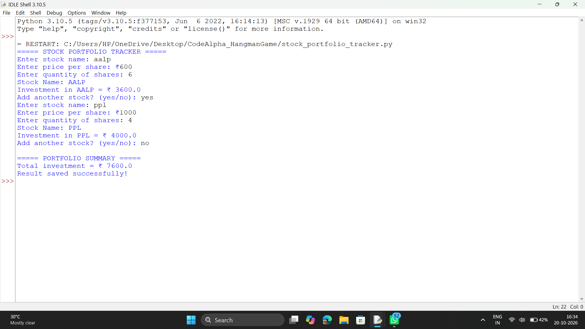

<div align="center">


### 📈 Track your stocks. Calculate your investment. Save the result.

</div>

---

## 📌 About the Project

The **Stock Portfolio Tracker** is a beginner-friendly Python console application built as part of the **CodeAlpha Python Programming Internship (Task 2)**.

The user enters stock details one by one. The program calculates the investment for each stock, keeps a running total, displays a portfolio summary, and saves the final result to a text file.

---

## ✨ Features

| | Feature |
|---|---|
| 📥 | Takes **stock name, price per share and quantity** as user input |
| 🧮 | Calculates investment for each stock (`price × quantity`) |
| ➕ | Keeps a **running total** across multiple stocks |
| ✅ | **Input validation**: price and quantity must be greater than zero |
| 🔁 | Add as many stocks as you want with a yes/no prompt |
| 📊 | Shows a clean **portfolio summary** |
| 💾 | Saves the result to `portfolio_result.txt` |

---

## 🛠️ Concepts Used

| Concept | Where it is used |
|---|---|
| Variables & basic arithmetic | Calculating investment and total |
| `input()` / `print()` | User interaction |
| `while` loop, `break`, `continue` | Adding multiple stocks |
| `if` conditions | Input validation |
| Type conversion (`float`, `int`) | Price and quantity |
| File handling (UTF-8) | Saving result to `.txt` |

---

## 🚀 How to Run

1. Install **Python 3** on your system.
2. Download this repository (**Code → Download ZIP**) and extract it.
3. Open a terminal in the project folder and run:

```bash
python stock_portfolio_tracker.py
```

---

## 💻 Sample Run

```text
===== STOCK PORTFOLIO TRACKER =====
Enter stock name: ppt
Enter price per share: ₹200
Enter quantity of shares: 6
Stock Name: PPT
Investment in PPT = ₹ 1200.0
Add another stock? (yes/no): no

===== PORTFOLIO SUMMARY =====
Total investment = ₹ 1200.0
Result saved successfully!
```

---

## 📸 Output Screenshot

<div align="center">



</div>

---

## 📁 Project Structure

```text
CodeAlpha_StockPortfolioTracker/
├── stock_portfolio_tracker.py   # main program
├── portfolio_result.txt         # saved result (generated on run)
├── output.png                   # screenshot of output
└── README.md                    # project documentation
```

---

## 👨‍💻 Author

**Arijit**
Python Programming Intern @ **CodeAlpha**

---

<div align="center">

⭐ **If you like this project, give it a star!** ⭐


</div>
